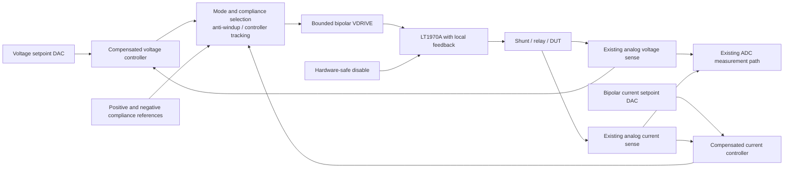

# LT1970A SMU power amplifier and current-control proposal

Status: preliminary engineering proposal, not a fabrication-ready schematic.

The connection-level schematic below describes a first PA prototype. The precision control diagram describes the subsequent SMU extension; its selector, compensation, and anti-windup circuits still require design. No firmware or existing KiCad files are changed.

## Recommended approach

Use the LT1970A as a locally regulated bipolar PA with independent coarse source/sink limits. Retain the existing voltage and current measurement hardware. Add external analog precision control for source-current operation, including a zero-current setpoint, and for low-current compliance.

Initial bench target: ±10 V and ±100 mA, with a deliberately restricted thermal envelope. Extend toward ±15 V and ±500 mA only after verifying headroom, sense common-mode range, load stability, and thermal limits. These are design targets, not guaranteed rectangular operating ranges.

Do not connect the existing ±18 V rails directly: 36 V is the device's absolute maximum total supply rating, leaving no tolerance or transient margin. Begin with regulated ±15 V rails. A higher-voltage version needs a worst-case supply budget below the absolute maximum and a review of the guaranteed electrical specifications.

## Connection-level PA schematic

```text
                          +15 V regulated
                                │
                        VCC ────┤
                         V+ ────┘

  VDRIVE ───────────────── +IN
                           ┌───────────────┐
  FB ───────────────────── −IN  LT1970A    │
                           │          OUT ├─────●── RCS 1 Ω ──●── KOUT ── FORCE+
  0…5 V limit source ────── VCSRC          │     │             │    relay
  0…5 V limit sink ──────── VCSNK          │     │             │
  PA_ENABLE ────────────── ENABLE         │     │             │
  AGND ─────────────────── COMMON         │     │             │
                           │        SENSE+ ├─────┘             │
                           │        SENSE− ├───────────────────┘
                           │        FILTER ├── Cfilter ────────┘
                           │               │
  3.3 V pull-ups ────────── ISRC/ISNK/TSD   │
                           └───────────────┘
                        VEE ────┐
                         V− ────┤
                                │
                          −15 V regulated

  POST_RCS (before KOUT) ───── Rf 40 kΩ ───●── FB
                                          │
                                        Rg 10 kΩ
                                          │
                                         AGND

  FORCE− ── existing return/current-measurement path ── PA return reference
```

Connections use pin names, not package pin numbers. Check every pin against the selected package before entering KiCad. The final FORCE− routing depends on the existing current-shunt placement; it is not established by this proposal.

Local closed-loop gain is nominally 1 + Rf/Rg = 5. A ±2 V VDRIVE requests ±10 V at POST_RCS. Feedback is taken after RCS but before KOUT, so the loop remains closed with the relay open. Voltage drop in the existing shunt, relay, and wiring is not corrected by this local loop; a later precision loop corrects DUT voltage.

If an existing 1 Ω shunt can safely serve the LT1970A limit sense function, consider sharing it instead of adding RCS. This requires checking its location, differential voltage, common-mode voltage, switching sequence, and Kelvin connections. Do not connect the LT1970A sense pins to an amplified current signal without a separately designed interface.

### Initial component and connection list

| Item | Proposed starting point | Design note |
|---|---|---|
| U1 | LT1970A, exposed-pad TSSOP | Adequate copper/thermal vias; use manufacturer footprint |
| RCS | 1 Ω, 0.1%, low drift, Kelvin sensing | At 500 mA: 0.5 V drop and 0.25 W; select margin and pulse rating |
| Rf / Rg | 40 kΩ / 10 kΩ, 0.1% | Local gain 5; compensation to be verified |
| VDRIVE | Bipolar command with hardware-safe startup | DAC level shifting and gain are a separate circuit |
| VCSRC / VCSNK | Independent unipolar controls relative to COMMON | Buffer/filter DAC signals; safe defaults required |
| Cfilter | Configurable footprint between FILTER and SENSE− | Determine from ADI short-circuit/reactive-load guidance and testing |
| Supply bypass | Start with 100 nF plus local bulk capacitance per rail | Locate ceramics at supply pins; size bulk from transient tests |
| ENABLE | Pull down, provisionally 10 kΩ, to COMMON | Reset, loss of control, and hardware fault must hold PA disabled |
| ISRC / ISNK / TSD | Separate open-collector status nets | Proposed 10 kΩ pull-ups to 3.3 V, with COMMON at AGND; verify MCU interface and startup conditions |
| KOUT | Existing or suitably rated output relay | Select voltage/current, leakage, and switching ratings |

The sketch omits completed supply protection, rail-clamp networks, DAC interfaces, and MCU pin assignments. An STM32 GPIO is not assigned or electrically approved by this document.

## Internal current limits

The manufacturer gives the nominal relationship:

`Ilimit = Vcontrol / (10 × RCS)`

For RCS = 1 Ω:

| Control voltage | Nominal limit magnitude |
|---:|---:|
| 0.1 V | 10 mA |
| 1.0 V | 100 mA |
| 2.5 V | 250 mA |
| 5.0 V | 500 mA |

The source and sink controls are independent. The device has a typical minimum sense threshold of about 4 mV; zero control voltage is not a zero-current command. With 1 Ω, the typical minimum limit magnitude is about 4 mA. The internal limiter limits current rather than requiring it to flow.

Use internal limiting as an independently bounded ceiling. Ensure DAC faults cannot request current beyond the selected thermal envelope. A limit flag reports compliance; thermal shutdown or loss of valid control requires a fault response. Do not automatically treat normal compliance as an instrument fault.

## Precision SMU extension



This is a functional diagram, not a completed selector schematic. Controller outputs must not be connected directly together. Design selection, saturation clamps, and tracking so that the inactive controller does not wind up while the active controller owns the PA command. Positive and negative compliance handling must be checked in all four voltage/current quadrants.

The proposed precision controllers use analog sense signals, not serial-console or desktop measurements. Keep the existing ADC conversion and filtering independent. A later slow firmware correction may adjust DAC setpoints using calibrated ADC readings after the analog loops are stable.

### Source-voltage mode

- The voltage controller adjusts VDRIVE from voltage-setpoint minus sensed voltage.
- External positive/negative current-compliance controllers override the voltage request when necessary.
- Internal LT1970A limits remain a separate coarse ceiling.

### Source-current mode

- A compensated current controller adjusts VDRIVE from current-setpoint minus sensed current.
- External positive/negative voltage-compliance controllers bound DUT voltage.
- Current-sense polarity must produce negative feedback; verify at low current before closing the full loop.
- At a 0 A setpoint, the controller adjusts voltage to cancel measured DUT current. This is an active connection, not isolation, and it may reach voltage compliance.

Define the current-sense gain for every range before selecting DAC scaling:

`V_ISENSE = K_range × I_DUT + analog_offset`

`V_ISET = K_range × I_requested + corrected_setpoint_offset`

Do not assume the existing ADC calibration directly calibrates this analog loop. Characterize DAC error, analog offsets, sense gain, drift, and low-current leakage separately. Any correction through firmware must have bounded authority and must not replace hardware protection.

## Detailed external compliance circuit

This section proposes an analog min/max controller selector. It is a circuit concept to simulate, not a tested drop-in design. The LT1970A internal limits remain independent protection; they do not perform the low-current precision functions below.

### Signal conventions and feedback polarity

Normalize the existing analog measurements to:

- `SV = Kv × V_DUT`, increasing with increasing DUT voltage.
- `SI = Ki_range × I_DUT`, increasing with positive current leaving FORCE+.
- `u = VDRIVE`, increasing with increasing PA output voltage.

If the physical current-sense signal is inverted, insert an inverter or reverse the error subtraction. The same convention must hold in every range. This proposal assumes increasing PA voltage increases DUT current locally; active or negative-resistance DUTs require separate stability analysis.

References are signed voltages in the same units as the respective sense signals. For example, an illustrative 1 V / 100 mA sense scale gives an upper +10 mA reference of +100 mV and a lower −10 mA reference of −100 mV. The actual scale must be obtained from the existing hardware.

### Three controllers in each mode

Each controller produces a candidate PA command, not a measured voltage/current. All candidate outputs use the same VDRIVE scale.

| Mode | Controller | Error input | Role |
|---|---|---|---|
| Source voltage | CV | `SV_set − SV` | Normal voltage regulation |
| Source voltage | CI_upper | `SI_upper − SI` | Prevent current exceeding the upper limit |
| Source voltage | CI_lower | `SI_lower − SI` | Prevent current falling below the lower limit |
| Source current | CI | `SI_set − SI` | Normal current regulation |
| Source current | CV_upper | `SV_upper − SV` | Prevent voltage exceeding the upper limit |
| Source current | CV_lower | `SV_lower − SV` | Prevent voltage falling below the lower limit |

Each is a compensated controller with positive low-frequency gain from its error to its candidate command. An upper-limit controller reduces its command when the measurement is too high. A lower-limit controller increases its command when the measurement is too low.

Source-voltage selection:

`u = MAX(CI_lower, MIN(CV, CI_upper))`

Source-current selection:

`u = MAX(CV_lower, MIN(CI, CV_upper))`

The final command is additionally bounded to the PA's allowed drive range. Valid configuration requires lower references below upper references and source setpoints within their corresponding bounds. Conflicting limits or persistent violations require disable rather than relying on selector priority to resolve an impossible condition.

```text
Source-voltage mode:

 SV_set − SV ── compensated CV ──────┐
                                     MIN ────┐
 SI_upper − SI ─ compensated CI_hi ──┘         MAX ── buffer / drive bounds ── u
 SI_lower − SI ─ compensated CI_lo ───────────┘

Source-current mode:

 SI_set − SI ── compensated CI ──────┐
                                     MIN ────┐
 SV_upper − SV ─ compensated CV_hi ──┘         MAX ── buffer / drive bounds ── u
 SV_lower − SV ─ compensated CV_lo ───────────┘
```

Mode changes must hold/disable the PA and initialize the controllers; a raw switch between unequal commands could produce a step. Initially implement one mode at a time, with fixed manual ranges.

### Precision MIN selector: actual diode/op-amp connections

Use two op-amp channels, one per candidate, with a shared feedback node M:

```text
 Candidate A ── (+) U_A
 Node M ─────── (−) U_A
 U_A output ── cathode D_A
 Node M ─────── anode D_A

 Candidate B ── (+) U_B
 Node M ─────── (−) U_B
 U_B output ── cathode D_B
 Node M ─────── anode D_B

 +Vselector ── Rpull ── Node M ── high-input-impedance buffer ── MIN_OUT
```

Whichever candidate is lower makes its op-amp sink the pull-up current through its diode. Its feedback regulates M to that candidate; the diode drop is inside the loop. The other diode is reverse biased. Do not use bare diodes between controller outputs and call the resulting threshold precise.

### Precision MAX selector

Reverse the diode orientations and use a pull-down:

```text
 Candidate A ── (+) U_A
 Node X ─────── (−) U_A
 U_A output ── anode D_A
 Node X ─────── cathode D_A

 Candidate B ── (+) U_B
 Node X ─────── (−) U_B
 U_B output ── anode D_B
 Node X ─────── cathode D_B

 Node X ── Rpull ── −Vselector
 Node X ── high-input-impedance buffer ── MAX_OUT
```

The larger candidate drives X through its diode. Again, the diode drop is enclosed by feedback. Cascade buffered MIN_OUT into the MAX selector and use the buffered MAX_OUT as the bounded PA drive command.

For a low-speed simulation prototype, ±5 V selector supplies and 10 kΩ pull resistors are reasonable starting assumptions if all candidates are restricted comfortably inside those rails. Final values depend on amplifier output current, common-mode limits, diode leakage/capacitance, selector loading, and desired bandwidth. Ensure the selector supply remains within its amplifier ratings.

These elementary selectors allow the inactive selector op-amp to saturate. Saturation recovery, crossover interaction between branches, and capacitive-node stability must be simulated and measured. A production implementation may need an improved non-saturating selector or clamp network; controller anti-windup alone does not cure selector-amplifier saturation.

### Controller and anti-windup implementation

A plain integrator will continue charging while another controller owns u. Prevent that with selected-output tracking. One proposed PI controller is:

`C = Kp × E + x`

`dx/dt = Ki × E + Kt × (u_actual − C)`

Here C is that controller's candidate command, E is its tabled error, and u_actual is the final drive after selection and command clamps. Feed the actual drive to every participating controller. This includes the normal source controller and both compliance controllers.

An op-amp implementation can use:

1. A difference amplifier for E, with matched resistor ratios.
2. A proportional gain stage for Kp × E.
3. An integrator state amplifier X, non-inverting input at AGND and feedback capacitor Cint.
4. Feed −E to its summing node through Ri.
5. Feed C − u_actual to the same node through Rt.
6. A summing stage to generate C = Kp × E + X with the correct polarity.

```text
 −E ───────── Ri ───┐
                   ●──── (−) U_X ───── x
 C − u_actual ─ Rt ─┘       (+)           │
                            │            │
                           AGND          │
                   ●────── Cint ─────────┘
                  summing node
```

This yields `Ki = 1/(Ri × Cint)` and `Kt = 1/(Rt × Cint)` with unity scaling in the two input paths. Ri, Rt, Cint, Kp, and any additional high-frequency poles must be selected from the measured plant response. They are not specified here because current-sense scaling/filtering and load requirements are not yet established. Account for the LT1970A local loop and the selector dynamics in that response.

During compliance, tracking limits the inactive controller's state excursion. During return to normal operation, it reduces the stored error responsible for overshoot. Add bounded candidate outputs and a reset/hold function for OFF and range switching. Back-calculation is a starting topology; simulation must show that it does not cause unacceptable boundary error or loop interaction.

The internal LT1970A limiter can also take control below the external limits during a fault. Controller tracking of u alone cannot detect this downstream override. Monitor ISRC/ISNK and use the confirmed internal-limit state to hold/unwind the outer controllers or disable after a defined fault response. Do not let an outer controller accumulate error against an internally limited PA.

### Compliance transition example

With source voltage set to +5 V and upper current compliance +10 mA:

- Into 1 kΩ, current is approximately 5 mA; CV owns the drive.
- Into 100 Ω, CV would request 50 mA. CI_upper lowers the permitted drive, takes ownership through MIN, and regulates approximately +10 mA. DUT voltage becomes approximately +1 V.
- When the load returns to 1 kΩ, current no longer requires the upper constraint, and CV regains control. Anti-windup is needed to avoid a voltage excursion during that handover.

For negative-current compliance, CI_lower takes ownership through MAX. The decision is based on signed current, not the sign of DUT voltage; test sourcing and sinking in all four quadrants.

In source-current mode at +10 mA with an upper voltage limit +5 V, a 1 kΩ DUT would require +10 V. CV_upper instead takes control and holds approximately +5 V, leaving current approximately +5 mA. Reaching compliance is normal behavior, not a guarantee that both setpoints can be satisfied.

### Zero current and low-current accuracy

Use CI with `SI_set = 0` for active zero-current regulation and retain voltage bounds. Do not set both external current-limit references to zero: that creates competing constraint loops, not the proposed zero-current source mode.

Sense offset, bias current, DAC error, leakage, and drift set the achievable residual DUT current. With illustrative Ki_range = 10 V/A, 100 µV of sense-reference error corresponds to 10 µA. Select lower-current ranges and suitable precision amplifiers to improve this; validate residual current against an independent reference.

### Op-amps, DACs, and compliance indication

A spare OPA4189 section is a candidate for sense/error processing, but verify the complete noise, bias, common-mode, output swing, saturation recovery, and compensation requirements. Selector amplifiers may prioritize clean recovery over ultra-low offset. Existing TL072 simulation models should not be treated as proof of low-current accuracy.

For full signed source and compliance operation, provide independently controllable references for the active source setpoint and both signed compliance bounds. DAC count depends on whether modes share channels and whether symmetric bounds are generated by an inverter. References must retain safe defaults during reset and communication loss.

External compliance status can be derived from selected-controller ownership and measured proximity to the bound, with hysteresis/filtering for indication. LT1970A ISRC/ISNK report its internal limiter, not ownership of this external selector. Firmware must distinguish external compliance, internal limiting, and thermal shutdown.

### Required simulation and bench checks

- Verify sense and drive polarities on every range before closing the precision loops.
- Establish loop gain/phase margins with CV, upper compliance, and lower compliance separately active.
- Repeat for current-source mode and both voltage bounds.
- Check diode-branch handover, inactive-amplifier saturation recovery, anti-windup, and command clamp recovery.
- Test resistive, capacitive, inductive/cabled, and externally driven loads in all four quadrants.
- Test internal-limit override, open sense leads, output OFF, mode switching, and shunt switching.
- Confirm dynamic overshoot remains within the permitted DUT envelope; steady-state compliance does not imply zero transient overshoot.

Reference context: [ADI AD8452 datasheet](https://www.analog.com/media/en/technical-documentation/data-sheets/ad8452.pdf) describes minimum-output selection for CC/CV control. The signed MIN/MAX extension above is this proposal's design, not an ADI-validated LT1970A reference circuit.

## Remote sense, range switching, and OFF behavior

Keep local PA feedback connected at all times. Remote sense is used by the outer precision controller only after verifying connections; disconnect detection must cause safe fallback or disable, not an uncontrolled rail command.

Do not carry measurement-only autorange sequencing into an active source without review. Switching a current shunt changes both the measurement scale and control-loop behavior. The transition needs coordinated command handling, controller hold/tracking, safe limit settings, settling, and calibration selection. Initially use manual fixed ranges while sourcing.

For output OFF, disable the PA and isolate with KOUT. Develop the switching sequence for an externally energized DUT and charged capacitance; opening the relay does not prove the DUT is discharged. Measurement inputs, the switchable 10 MΩ input impedance, relay leakage, and protection networks may still draw DUT current. Retain the existing rule that the 10 MΩ path is not enabled while the PA is active.

## Thermal and electrical envelope

For a preliminary ±15 V supply and 100 mA prototype:

- A zero-volt short at 100 mA dissipates approximately 1.5 W in the conducting output path.
- At −10 V while sourcing +100 mA, dissipation is approximately 2.5 W, before accounting for how losses split between RCS and the device.
- At −10 V while sourcing +500 mA, the same calculation gives approximately 12.5 W. This is not a safe continuous rating without a verified thermal design.

Add quiescent power and other losses to thermal calculations. Determine allowable output current as a function of DUT voltage, rail voltage, temperature, and duty cycle. Low output current does not remove the need to check opposite-quadrant dissipation.

Review external DUT voltage, powered/unpowered states, sense pin limits, supply sequencing, clamp current paths, and rail energy absorption. The output relay and PA protection must tolerate the intended external voltage envelope.

## Bench implementation sequence

1. Verify package pins, supply margin, grounding, existing shunt placement, and current/voltage sense scaling.
2. Build the local-feedback PA with ±15 V regulated rails, modest internal limits, and no DUT connected. Verify default disable and status outputs.
3. Test a resistive load at reduced voltage/current. Compare command, POST_RCS, DUT voltage, ADC readings, and reference instruments.
4. Test current-limit entry/recovery in both polarities, then capacitive loads, shorts, externally driven outputs, startup, and shutdown.
5. Establish thermal and current-versus-voltage limits before increasing current.
6. Add the compensated outer voltage loop, initially using local sense.
7. Add the precision current loop and voltage compliance; test both current signs and zero-current regulation against an external voltage source.
8. Implement loop tracking/anti-windup and source-safe range switching.
9. Add remote-sense fault handling and validate the PA monitor proposed separately.
10. Run KiCad ERC and structural PCB DRC before finalizing a schematic/layout revision.

## References and unresolved design decisions

- [ADI LT1970A datasheet](https://www.analog.com/media/en/technical-documentation/data-sheets/1970afc.pdf): supply and sense limits, current-control equations, minimum threshold, ENABLE behavior, filtering, and thermal guidance.
- [ADI LT1970A product page](https://www.analog.com/en/products/lt1970a.html): evaluation-board and design resources.
- [PA output voltage monitor proposal](pa-output-voltage-monitor-proposal.md): possible reuse of ADC CH2.

Before producing a fabrication-ready schematic, resolve DAC selection/scaling, sense signal loading and common-mode range, controller op-amps, compensation, selector topology, protection, rail regulation, and thermal construction. The final ±15 V / 500 mA capability is not established by this proposal.
